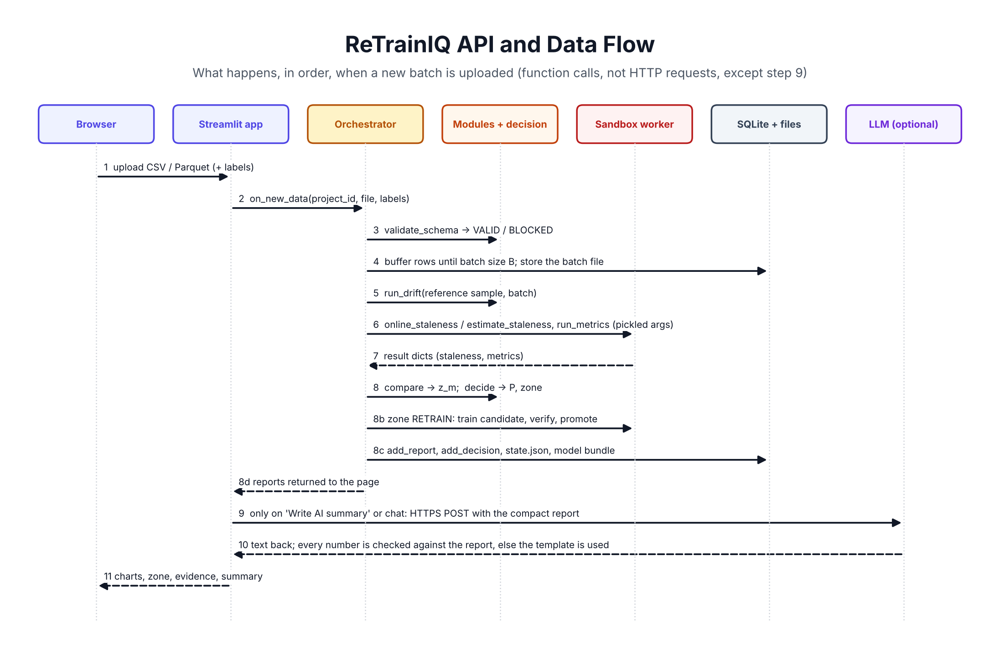

# ReTrainIQ API reference

This document lists what the code actually calls. It was written from the source, not from the design notes.

## A. External APIs

There is exactly one kind of external service call, plus one external command.

| # | What | Where in the code | When it runs |
|---|---|---|---|
| 1 | LLM chat completion over HTTPS | `5-Analysis/ri_analysis/llm.py`, class `HTTPLLM` | Only if an LLM is configured, and only for: profile draft at setup, metric-plan proposal, "Write AI summary", and AI Assistant questions |
| 2 | `git clone --depth 1` of a public GitHub repository | `1-Profile/ri_profile/understand.py`, `fetch_repo` | Only when a GitHub URL is given in Project Setup |

Nothing else leaves the machine: no telemetry, no cloud storage, no hosted database, no GitHub REST API, no model-serving API. The Streamlit UI and the pipeline run in one local Python process; SQLite is a local file.

### 1. LLM provider

| Item | Detail |
|---|---|
| Provider | Chosen by you. `anthropic` uses the Anthropic Messages API. Any other value uses an OpenAI-compatible `chat/completions` endpoint (`openai`, `groq`, `gemini`, `ollama`, or your own with `LLM_BASE_URL`). |
| SDK | None. Plain `requests.post`. No provider SDK is installed. |
| Authentication | Anthropic: header `x-api-key` plus `anthropic-version: 2023-06-01`. OpenAI-compatible: header `Authorization: Bearer <key>`. |
| Environment variables | `LLM_PROVIDER`, `LLM_API_KEY`, `LLM_MODEL`, optional `LLM_BASE_URL`. Read from the process environment or from `.env` in the repo root (`.env` is git-ignored). |
| Request (Anthropic) | `POST {base}/v1/messages` with `{"model", "max_tokens": 1500, "temperature": 0, "system", "messages": [{"role": "user", "content"}]}` |
| Request (OpenAI-compatible) | `POST {base}/chat/completions` with `{"model", "temperature": 0, "messages": [system, user]}` |
| Response used | Anthropic: concatenated `content[].text`. OpenAI-compatible: `choices[0].message.content`. For JSON tasks the first `{...}` block is parsed. |
| What is sent | File excerpts of the scanned repository (profile draft), or the compact report: aggregated metrics, drift table, staleness numbers. **Dataset rows are never sent.** |
| Error handling | Network errors and HTTP status ≥ 400 raise `LLMError`. Every caller catches it and falls back: heuristic profile, default metric plan, template summary, rule-based chat answer. |
| Output checks | Summary and chat text are accepted only if every number in them matches a number in the stored report (`validate_summary`); a summary must also end with the engine's own zone. One retry, then the template. |
| Logging | Model name, prompt and response are written to the `llm_log` table. |
| Cost | Charged by your provider per token. One summary sends roughly 1 to 3 thousand tokens of JSON. No call is made unless you press the button or ask a question. |
| Status | The request and response shapes follow the providers' published formats, but **no live call was made during development** (no key was available). Test it with your key before the demo. The default base URLs for `gemini` and `groq` should be checked against the providers' current documentation. |

### 2. GitHub

There is no GitHub API integration. `fetch_repo` accepts only URLs of the form `https://github.com/<owner>/<repo>`, runs `git clone --depth 1` as a subprocess with a 120-second timeout and `GIT_TERMINAL_PROMPT=0`, then deletes the `.git` folder. Private repositories are therefore not supported; upload a ZIP instead. No token is used or stored.

## B. Internal interfaces

The frontend imports the packages and calls functions directly. There is no REST layer.

### Frontend → backend

| UI action | Function called |
|---|---|
| Analyse Project | `understand.fetch_repo` / `extract_zip_safe` → `scan_project` → `heuristic_profile` (and `extract_profile` with an LLM) → `verify_profile` |
| Confirm Profile | `understand.finalize_profile` → `orchestrator.setup_project` |
| Run check | `orchestrator.on_new_data(project_id, file_path, labels_path=None)` |
| Attach labels | `orchestrator.attach_labels(project_id, batch_id, labels_path)` |
| Retrain / Keep | `orchestrator.resolve_human(project_id, report_id, choice, force=False)` |
| Rollback | `orchestrator.rollback(project_id)` |
| Load / reset demo, demo step 1 | `orchestrator.reset_project(project_id)` |
| What if? | `ri_analysis.chat.default_tools(project_id)["what_if"]` → `cara_t.tau_for_kappa` + `decision.what_if` |
| Write AI summary | `ri_analysis.summary.summarize_with_meta(report)` |
| AI Assistant | `ri_analysis.chat.chat(question, project_id)` |
| Reading pages | `store.get_reports`, `get_decisions`, `get_versions`, `get_active_version`, `get_batch` |

### Module 1: `ri_profile.understand`

`fetch_repo(url, dest)`, `extract_zip_safe(zip_path, dest, max_mb=300, max_files=5000)` (rejects absolute paths, `..`, symlinks), `scan_project(path)` → `{file_tree, readme, requirements, model_files, data_files, scripts_and_notebooks, key_py_snippets}`, `build_context(scan, max_chars=20000)`, `extract_profile(context, llm)`, `heuristic_profile(scan, dataset_path, target)`, `verify_profile(profile)` → list of issues, `finalize_profile(profile, user_edits)`.

### Module 2: `ri_drift`

`drift.fit_reference(reference_df, profile)`, `drift.validate_schema(df, profile, reference=None)` → `{status: VALID|BLOCKED, issues, missing_columns, unseen_categories, out_of_range}`, `drift.run_drift(reference_df, new_df, profile)` → `{status: STABLE|DRIFT, drift_share, per_feature[], n_ref, n_new, missing_rate}`, `drift.prediction_shift(...)`; `plots.drift_bar`, `plots.distribution_overlay`, `plots.top_drifted`; `scenarios.inject_covariate_shift`, `inject_concept_shift`, `make_invalid_upload`, `hold_back_labels`, `build_scenario_stream`.

### Module 3: `ri_cara`

`cara_t.calibrate(model_path, history_df, profile, cfg)` → `{status, tau_star, kappa, s, gamma, cost_matrix, proxy, ...}`; `cara_t.online_staleness(model_path, new_df, train_sample_df, calib, profile, seed)` → measured result with `staleness`, `staleness_lo`; `cara_t.estimate_staleness(...)` → label-free result with `staleness_est`, `staleness_est_lo`; `cara_t.tau_for_kappa(calib, multiplier)`; `replay_baselines.build_bank / run_baselines / simulate / oracle`; `proxy_eval.run_proxy_eval(profile, cfg)`.

### Module 4: `ri_metrics.metrics`

`REGISTRY`, `default_plan(profile)`, `validate_plan(plan, profile=None)`, `run_metrics(model_path, df_labelled, profile, plan, n_boot=200, seed=42)`, `compute_baseline(model_path, holdout_df, profile, plan)`, `compare(baseline, current, primary_metric)` → adds `z_m`, `degraded`, `table`.

### Decision engine: `ri_decision.decision`

`decide(drift, cara, quality, cfg=None)` → `{P, zone, zc, zm, d, reason, basis, terms, flags}`; `what_if(drift, cara, quality, cfg_overrides)`.

### Retraining engine: `ri_decision.retrain`

`build_training_data`, `train_candidate`, `verify`, `promote`, `rollback`, `save_bundle`, `load_bundle`, `run_retrain_cycle(project_id, trigger, report_id=None, force=False)`, `shadow_check(project_id, batch_df)`, `rollback_project(project_id)`.

### Orchestrator: `ri_decision.orchestrator`

`setup_project(profile)`, `on_new_data(project_id, file_path, labels_path=None)`, `attach_labels(project_id, batch_id, labels_path)`, `resolve_human(project_id, report_id, choice, force=False)`, `rollback(project_id)`, `reset_project(project_id)`.

### SQLite store: `ri_init.store`

Tables: `projects`, `model_versions`, `batches`, `reports`, `decisions`, `llm_log`. Functions: `init_db`, `add_project`, `get_project`, `delete_project`, `add_batch`, `get_batch`, `get_batches`, `update_batch`, `add_report`, `update_report`, `get_report`, `get_reports`, `add_decision`, `get_decisions`, `add_version`, `get_versions`, `set_active_version`, `get_active_version`, `add_llm_log`.

### Sandbox worker: `ri_init.worker`

`run_in_worker("package.module:function", kwargs, timeout=900)` starts `python -m ri_init.worker_main` as a subprocess, passes the arguments and reads the result through temporary pickle files, kills the process on timeout, and raises `WorkerError` with the child's stderr on failure. On Linux and macOS the child also sets a 4 GB memory limit and a CPU-time limit; on Windows only the timeout applies.

### Command line: `python -m ri_decision.cli`

`setup`, `replay`, `evaluate`, `resolve`, `versions`, `rollback`, `reset`, `watch` (drop folder checked every `5h`, `1d`, `1w`...).

The exact signatures are fixed in [CONTRACT.md](../CONTRACT.md) and checked by `python tools/status.py`.
