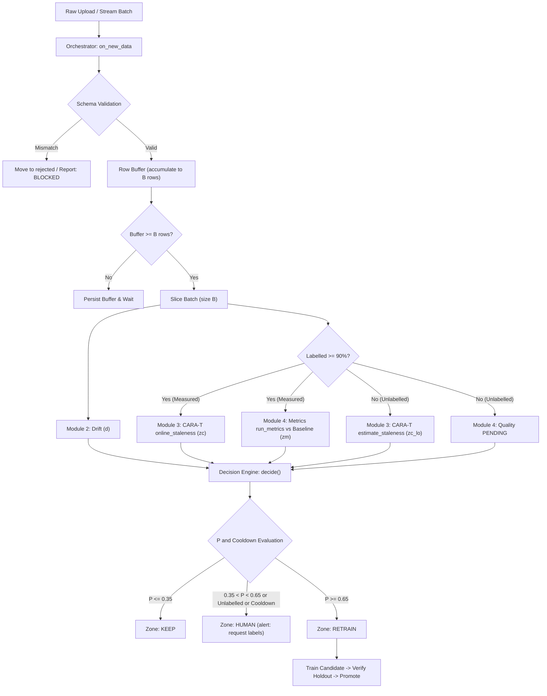

# ReTrainIQ Architecture

ReTrainIQ provides automated continuous monitoring, staleness detection, and retraining decision automation for production ML systems.

<!-- TODO: Reference blueprint.png or blueprint_four_modules.png once diagram asset is added -->

## 1. End-to-End Data Flow

## 2. Decision Score ($P$) Formulation

The composite decision score is computed via a calibrated sigmoid:

$$P = \sigma(b + a_1 z_c + a_2 z_m + a_3 d)$$

Where:
- $b$: Base intercept ($0.0$).
- $a_1$: Weight on CARA-T staleness ($1.5$).
- $a_2$: Weight on metric performance degradation ($1.0$).
- $a_3$: Weight on feature drift share ($0.5$).
- $z_c$: Standardized staleness deviation clipped to $[-3.0, 3.0]$.
- $z_m$: Standardized metric degradation clipped to $[-3.0, 3.0]$.
- $d$: Feature drift ratio $[0.0, 1.0]$.

### Safety Invariant
The drift coefficient $a_3$ is mathematically restricted such that:

$$a_3 < \ln\left(\frac{\text{retrain\_limit}}{1 - \text{retrain\_limit}}\right)$$

This guarantees that covariate drift alone cannot trigger an automated retraining action without supporting performance or CARA-T evidence.

## 3. Contract v2: Hybrid Label-Free & Late-Label Governance

In production, ground-truth labels often arrive with variable latency (label lag $L$):
1. **Unlabelled Batches:** The system runs drift detection and CARA-T confidence-based estimation (`estimate_staleness`), setting `basis='estimated'` and capping the operational zone at `HUMAN` with the alert `request labels`.
2. **Late-Label Attachment:** When ground-truth labels are supplied later via `attach_labels(batch_id, labels)`, the orchestrator re-evaluates true measured staleness and metric degradation, calculates proxy estimation error ($\text{proxy\_error} = \text{staleness}_{\text{est}} - \text{staleness}_{\text{meas}}$), updates the persistent report, and logs decision actions idempotently.

