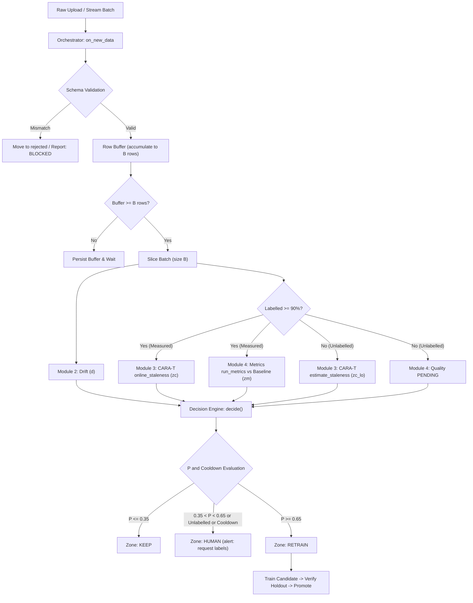

# ReTrainIQ Architecture

ReTrainIQ provides automated continuous monitoring, staleness detection, and retraining decision automation for production ML systems.

<!-- TODO: Reference blueprint.png or blueprint_four_modules.png once diagram asset is added -->

## 1. End-to-End Data Flow

## 2. Decision Score ($P$) Formulation

The composite decision score is computed via a calibrated sigmoid:

$$P = \sigma(b + a_1 z_c + a_2 z_m + a_3 d)$$

Where:
- $b$: Base intercept ($0.0$).
- $a_1$: Weight on CARA-T staleness ($1.5$).
- $a_2$: Weight on metric performance degradation ($1.0$).
- $a_3$: Weight on feature drift share ($0.5$).
- $z_c$: Standardized staleness deviation clipped to $[-3.0, 3.0]$.
- $z_m$: Standardized metric degradation clipped to $[-3.0, 3.0]$.
- $d$: Feature drift ratio $[0.0, 1.0]$.

### Safety Invariant
The drift coefficient $a_3$ is mathematically restricted such that:

$$a_3 < \ln\left(\frac{\text{retrain\_limit}}{1 - \text{retrain\_limit}}\right)$$

This guarantees that covariate drift alone cannot trigger an automated retraining action without supporting performance or CARA-T evidence.

## 3. Contract v2: Hybrid Label-Free & Late-Label Governance

In production, ground-truth labels often arrive with variable latency (label lag $L$):
1. **Unlabelled Batches:** The system runs drift detection and CARA-T confidence-based estimation (`estimate_staleness`), setting `basis='estimated'` and capping the operational zone at `HUMAN` with the alert `request labels`.
2. **Late-Label Attachment:** When ground-truth labels are supplied later via `attach_labels(batch_id, labels)`, the orchestrator re-evaluates true measured staleness and metric degradation, calculates proxy estimation error ($\text{proxy\_error} = \text{staleness}_{\text{est}} - \text{staleness}_{\text{meas}}$), updates the persistent report, and logs decision actions idempotently.

## 4. Retraining, Verification, and Rollback

Automatic `RETRAIN` decisions and human-approved retrains enter the same `run_retrain_cycle`:

1. Select the most recent `W` batches with at least 90% labelled rows. The newest batch is kept in time order; its first 80% joins the training data and its last 20% is the verification slice.
2. Clone and fit the active scikit-learn pipeline in the worker process. Compare the candidate and champion on the verification slice with a paired bootstrap; also enforce the primary-metric holdout tolerance and the binary positive-class recall guard.
3. Keep failed candidates registered as `rejected` and record their training duration. A passing candidate is atomically promoted, registered as active, and gets a versioned bundle containing its model, calibration, baseline, training sample, and drift reference.
4. Recompute calibration from up to `offline_batches_N` labelled batches when at least ten are available; otherwise preserve the previous calibration and report a warning. Refresh the holdout baseline, training sample, and drift reference after promotion.
5. Track the prior model for three labelled batches. A mean primary-metric regression greater than 0.02 raises a rollback suggestion; automatic rollback is disabled unless `auto_rollback` is enabled. `rollback --project <id>` restores the previous model and its full bundle.

## Additions of 2026-11-12

**Offline CARA-T step (at setup and after each promotion).** The most recent N x B ordered labelled rows are
cut into N batches; one model per batch is trained with the online recipe (`clone(pipeline).fit` on the last
W batches); the cost matrix `C[t', t] = PsiBar(t, t')` is built from 500 sampled queries and 2,000 sampled
points per batch; `kappa` = median positive offline staleness x multiplier; `tau*` = the plateau midpoint
with the lowest simulated strategy cost (ties: the largest). If never retraining is cheapest offline,
`tau*` is set one standard deviation above the largest offline value and flagged `tau_extrapolated`.

**Lower bounds.** The decision score uses the 5% bootstrap lower bound of measured staleness, and the
lower bound of the label-free estimate. Automatic retraining therefore needs staleness that is above
`tau*` beyond sampling noise.

**CARA-T-L.** Expected loss `1 - g(confidence)` replaces the 0-1 loss, where `g` is an isotonic map fitted
on the holdout. The proxy is mapped to the measured scale by an isotonic map fitted on offline batch
pairs (slope-1 extrapolation outside the fitted range) and reduced by the 90th percentile of the offline
residuals. When labels arrive, the measured value replaces the estimate and their difference is stored.

**Verification gates.** (1) 5% paired-bootstrap lower bound of the accuracy gain on the newest slice >= margin;
(2) primary metric drop on that slice <= 0.02; (3) positive-class recall drop <= 0.02; (4) drop on the
reference holdout <= 0.02. Gates 2 to 4 are waived when the champion's accuracy on the newest slice is
below its holdout accuracy by more than max(0.02, 3 standard errors): the holdout is then out of date,
and the verification slice becomes the baseline of the promoted version.

**Evaluation.** `cli evaluate` builds a bank with one model per batch and replays every strategy as
look-ups (test-then-train; J = staleness + kappa x retrains), so all strategies share models and costs.
