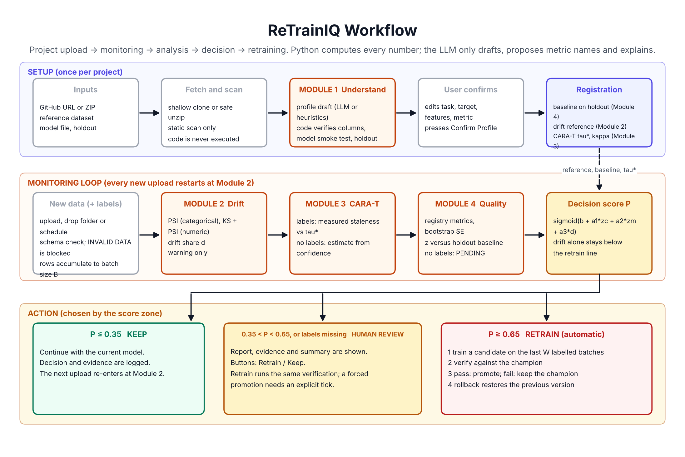
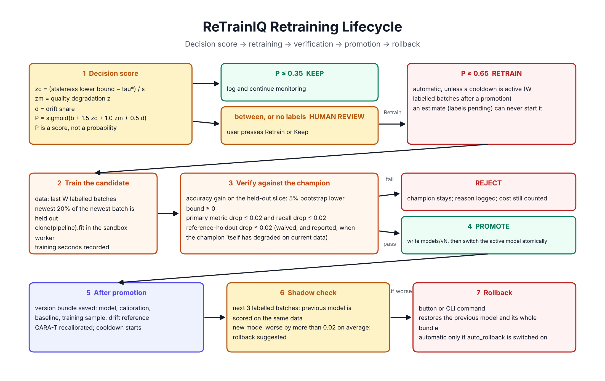

# Data flow

## 1. Setup (once per project)

1. **Inputs.** GitHub URL or ZIP, the reference dataset (the data the model was trained on), the model file, optionally a holdout the model never saw.
2. **Scan.** The repository is cloned or unzipped into `workspace/<id>/repo` and read as text. No file from it is executed or imported.
3. **Profile.** A draft `profile.json` (task, target, features, model, primary metric, batch size) comes from heuristics, or from the LLM when one is configured. Code then verifies it: columns exist, the target is not a feature, class balance, and the model loads and predicts on 20 raw rows inside the sandbox worker.
4. **Confirmation.** You edit and confirm the profile.
5. **Registration** (`setup_project`). Files written under `workspace/<id>/`:

| File | Content | Used by |
|---|---|---|
| `models/v1/model.joblib`, `models/active/model.joblib` | The registered model | Everything that predicts |
| `data/train_sample.csv` | 2,000 random reference rows | Drift reference; CARA-T reference term |
| `reference_stats.json` | Bins, shares, 1st and 99th percentiles of the reference | Schema validation |
| `baseline.json` | Metrics of v1 on the holdout, with bootstrap errors | Module 4 comparison |
| `calib.json` | tau*, kappa, s, gamma, scaler, offline cost matrix, label-free maps | Module 3 |
| `state.json` | Active version, cooldown, shadow counters, upload hashes | Orchestrator |

How the reference dataset is used: its most recent `N x B` rows (25 x batch size) are cut into 25 ordered batches for the offline CARA-T step; a 2,000-row sample of it is the comparison data for drift and staleness. It is never modified.

## 2. Monitoring (every upload)

1. **Upload** through the page, or a file dropped in the watch folder. A SHA-256 hash stops the same file being processed twice.
2. **Schema validation.** A missing feature column or a numeric column that cannot be cast blocks the upload (zone `BLOCKED`, shown as INVALID DATA); the file is copied to `data/rejected/`.
3. **Batching.** Rows are appended to `data/buffer.csv`. Each time the buffer holds `B` rows, one batch is cut and stored as `data/batches/batch_NNN.csv`. A batch counts as labelled when at least 90% of its target values are present.
4. **Module 2** compares the batch with the training sample. Always runs.
5. **Modules 3 and 4** run in the sandbox worker. Labelled batch: measured staleness and metrics. Unlabelled batch: the label-free staleness estimate; quality stays PENDING.
6. **Decision.** `decide` combines the three results into `P` and a zone. Unlabelled batches always end in HUMAN. During a cooldown a RETRAIN is downgraded to HUMAN.
7. **Action.** RETRAIN starts the retraining cycle (below). Everything is stored: one `reports` row (four JSON documents and the zone) and one or more `decisions` rows.
8. **Late labels.** `attach_labels` joins a label file to the stored batch (by id column or row order), recomputes Modules 3 and 4 with measurements, stores the difference between the earlier estimate and the measured staleness, and decides again.

## 3. Retraining

Training data is the last `W` labelled batches without the newest 20% of the newest batch, which is the verification slice. The candidate is `clone(champion).fit(...)` in the sandbox. It is promoted only if verification passes. On promotion the new version gets its own bundle (model, calibration, baseline, training sample, drift reference), the active model file is replaced atomically, CARA-T is recalibrated when at least 10 labelled batches exist, a cooldown of `W` labelled batches starts, and for the next 3 labelled batches the previous model is scored on the same data (shadow check). Rollback restores the previous bundle.

## 4. What the LLM sees

Only text excerpts of the scanned repository (profile draft) and the compact report (aggregated numbers). Never dataset rows, never the model file.
