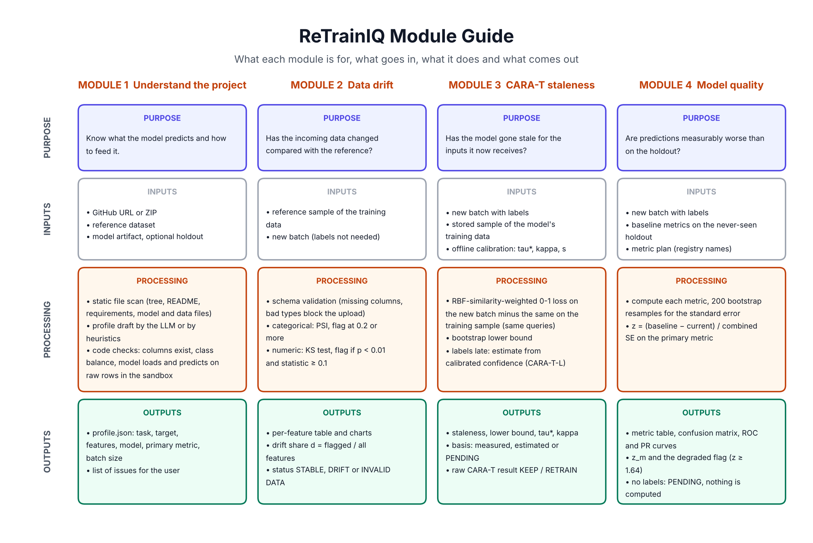
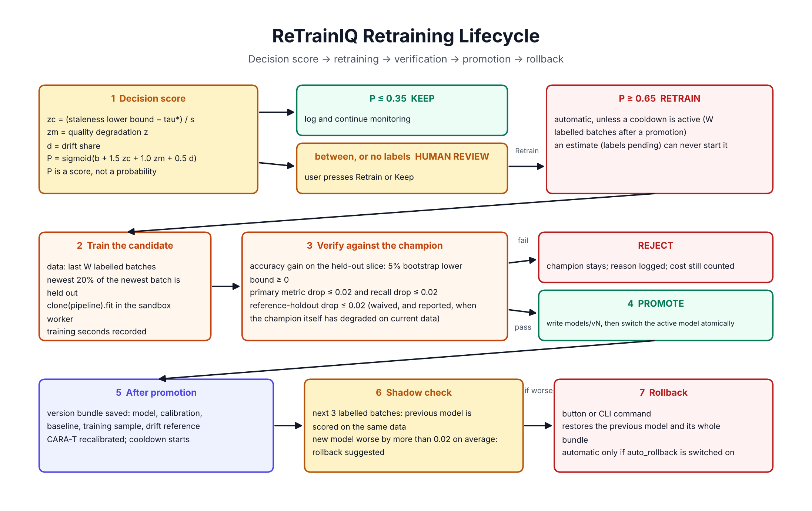

# ReTrainIQ: project explanation

Written for the final-year evaluation. Three kinds of statement are kept apart: **implemented** (in this repository and tested), **design choice** (a decision, with its reason), and **future work** (not done).

## 1. Problem statement

A deployed machine-learning model is trained once on past data. The world keeps changing, so its predictions slowly or suddenly get worse. Someone has to decide, for every new batch of data, whether to keep the model or retrain it. Retraining too often wastes compute and can replace a good model with a worse one. Retraining too late means wrong predictions in production. True outcomes (labels) often arrive late, so the decision frequently has to be made with incomplete evidence.

## 2. Motivation

In the team's earlier experiments on Electricity, Covertype and Airlines, no retraining policy won on every criterion, the result depended strongly on an assumed retraining cost, every policy needed the true labels of the current batch, and a retrained model was put into use without being compared with the old one. ReTrainIQ addresses those four observations.

## 3. Existing approaches and their limits

| Approach | Limit |
|---|---|
| Never retrain | Accuracy decays after any real change. |
| Periodic retraining | Retrains when nothing changed; waits when something did. |
| Drift-triggered (DDM, ADWIN, PSI alarms) | Drift in the inputs does not imply worse predictions, and predictions can get worse without input drift. |
| CARA (Mahadevan and Mathioudakis, 2024) | Balances staleness against retraining cost, but needs current labels, uses one fixed cost, and does not verify the new model. |

## 4. Proposed system

ReTrainIQ is an advisor around an existing scikit-learn model. It reads the project once (Module 1), then for every new batch measures drift (Module 2), CARA-T staleness (Module 3) and quality (Module 4), combines them in one decision score, and acts by zone: keep, ask a human, or retrain automatically. A retrained candidate is promoted only after verification, and can be rolled back.

## 5. Objectives

1. Work with an existing project (GitHub link or ZIP, dataset, saved model) without running its code.
2. Use three kinds of evidence instead of one.
3. Keep every number deterministic and reproducible; use the LLM only for understanding and explaining.
4. Never replace a model without checking the replacement.
5. Stay useful when labels are late.
6. Evaluate against standard policies and report negative results.

## 6. Architecture

See [SYSTEM_ARCHITECTURE.md](SYSTEM_ARCHITECTURE.md) and [DATA_FLOW.md](DATA_FLOW.md). One Streamlit process holds the UI and a plain-Python orchestrator; model code runs in a sandbox subprocess; state is in SQLite and in files under `workspace/`.

## 7. The four modules (implemented)

- **Module 1** scans the project as text, drafts a profile (heuristics, or an LLM), verifies it with code, and smoke-tests the model on raw rows in the sandbox.
- **Module 2** compares every batch with a reference sample and validates the upload.
- **Module 3** computes CARA-T relative staleness against a threshold calibrated offline; without labels it estimates staleness from model confidence.
- **Module 4** computes registry metrics with bootstrap standard errors and compares the primary metric with the holdout baseline.

## 8. Algorithms and mathematics

**PSI** for a feature with reference shares `q_i` and new shares `p_i` over bins or categories: `PSI = Σ (p_i − q_i) ln(p_i / q_i)`. Numeric features use 10 bins from reference deciles. Zero shares are replaced by 0.0001. Flag at PSI ≥ 0.2 for categorical features.

**KS test** for numeric features: the largest gap between the two empirical distribution functions. Flag when p < 0.01 **and** the statistic ≥ 0.1; the second condition stops very large batches from flagging tiny shifts.

**Drift share** `d` = flagged features / all features.

**CARA-T staleness.** For a query `q`, data `D` and model `M`:

`ψ(q, D, M) = (1/|D|) Σ_{(x,y)∈D} sim(q, x) · loss(M, x, y)`, with `sim(q, x) = exp(−γ‖q − x‖²)` and 0-1 loss.

`Ψ(Q, D, M) = Σ_{q∈Q} ψ(q, D, M)`. Relative staleness of the active model on a new batch:

`Ψ̄ = Ψ(Q_new, D_new, M) − Ψ(Q_new, D_train, M)`

The same queries are used in both terms, so a rise that only comes from queries moving to another region is removed. The rule is RETRAIN if `Ψ̄ ≥ τ*`.

**Offline calibration.** History is cut into N batches; one model per batch is trained; `C[t', t] = Ψ̄(t, t')` is the cost of using the model from batch `t'` at batch `t`; retraining costs `κ`. Every candidate threshold is replayed on the history (Algorithm 1 of the paper) and `τ*` is the one with the lowest total cost.

**Quality z.** `z_m = (m_ref − m_new) / sqrt(se_ref² + se_new²)`, sign flipped for lower-is-better metrics; standard errors from 200 bootstrap resamples; degraded at `z_m ≥ 1.64`.

**Decision score.** `z_c = (staleness − τ*) / s`, clipped to ±3, where `s` is the standard deviation of offline staleness values and the staleness used is its 5% bootstrap lower bound. `P = sigmoid(b + a1·z_c + a2·z_m + a3·d)` with `b = 0, a1 = 1.5, a2 = 1.0, a3 = 0.5`. Zones: `P ≥ 0.65` RETRAIN, `P ≤ 0.35` KEEP, otherwise HUMAN.

## 9. The CARA-T paper and our adaptation

Taken from the paper: the staleness definition, relative staleness with shared queries, the cost matrix, the offline choice of a threshold, the Markov baseline and the Oracle. **Our adaptations (design choices, stated openly; this is not an exact reproduction):**

| Paper | Here | Reason |
|---|---|---|
| Parameters found with dual annealing | Exhaustive search over the distinct offline values, each plateau represented by its midpoint | Exact for a single threshold, reproducible, no optimiser settings. |
| Raw features in the kernel | The champion's preprocessing output, standardised | Works for mixed numeric and categorical data. |
| γ fixed per dataset | γ = 1 / median squared pairwise distance | A project-independent default. |
| Decision on the point value | Decision on the 5% bootstrap lower bound | On stable data staleness fluctuated around τ* and caused random triggers. |
| Retrained model used directly | Candidate must pass verification | A retrain can fail to help. |
| Labels assumed available | CARA-T-L estimate while labels are pending | Labels are often late. |

**CARA-T-L (our extension).** The 0-1 loss is replaced by an expected loss `1 − g(confidence)`, where `g` is an isotonic map from model confidence to the probability of being correct, fitted on the holdout. The resulting proxy is mapped onto the measured scale with a second isotonic map fitted on offline batch pairs, and reduced by the 90th percentile of the offline error. An estimate can only send a batch to human review. When labels arrive the measured value replaces it and the error is stored. Related work exists on estimating accuracy from confidence without labels (for example Garg et al., ICLR 2022, "Leveraging Unlabeled Data to Predict Out-of-Distribution Performance"). **A full literature search has not been done, so no novelty claim should be made beyond: this estimate is used inside a query-aware, cost-aware retraining decision, on CARA-T's scale.**

## 10. Retraining and verification (implemented)

Training data: the last `W` labelled batches; the newest 20% of the newest batch is the verification slice. Gates: (1) the 5% paired-bootstrap lower bound of the accuracy gain over the champion is at least 0; (2) the primary metric drops by at most 0.02; (3) positive-class recall drops by at most 0.02; (4) the drop on the reference holdout is at most 0.02. Gates 2 to 4 are waived, and the waiver is reported, when the champion's own accuracy on the new slice is below its holdout accuracy by more than max(0.02, three standard errors): the holdout then no longer describes current data. After promotion: version bundle, recalibration, cooldown of `W` labelled batches, and a three-batch shadow comparison with the previous model.

## 11. Versioning, database, sandbox, LLM

See [SYSTEM_ARCHITECTURE.md](SYSTEM_ARCHITECTURE.md) (versions, tables, sandbox limits) and [API_REFERENCE.md](API_REFERENCE.md) (LLM call, what is sent, how output is checked). In short: versions are folders with a full bundle; SQLite holds projects, versions, batches, reports, decisions and the LLM log; all model loading and training happens in a subprocess; the LLM drafts the profile, proposes metric names from the registry and writes text whose numbers are checked.

## 12. Evaluation methodology (implemented)

`python -m ri_decision.cli evaluate` builds a bank with one model per batch and replays every strategy as look-ups, so all strategies share the same models and costs. Order of events is test-then-train. Cost `J = Σ staleness + κ × retrains`. Strategies: Never, Always, Periodic, Markov, CARA-T, the ReTrainIQ score (automatic zone only), and the Oracle (dynamic programming with knowledge of the future; a lower bound, not a deployable policy). It also runs a sensitivity sweep, an out-of-time calibration test of the score, and a label-delay test of CARA-T-L.

## 13. Experimental results actually available

**Only one set exists: the synthetic demo stream (50 batches of 2,000 rows, one seed, a simulated concept shift after batch 25).** Files are in `docs/results_demo/`.

| Strategy | Retrains | Total cost J | % above Oracle |
|---|---|---|---|
| Never | 0 | 4482.9 | 37.7 |
| Always | 50 | 6598.3 | 102.6 |
| Periodic (every 5) | 10 | 4046.5 | 24.3 |
| Markov | 21 | 4629.7 | 42.2 |
| CARA-T | 10 | 3859.4 | 18.5 |
| ReTrainIQ score, automatic zone, no verification | 6 | 3607.4 | 10.8 |
| Oracle (retrospective) | 1 | 3256.5 | 0 |

- Full pipeline replay of 40 batches: 26 stable batches gave 22 KEEP and 4 HUMAN and no automatic retrain; the shifted batch scored 0.999 and a candidate was trained, verified and promoted; the next 13 batches were KEEP.
- Score calibration: coefficients fitted on earlier decision points were worse out of time than the starting ones (Brier 0.050 against 0.019). Therefore the coefficients were kept and **P is a decision score, not a probability.**
- CARA-T-L: under a simulated shift towards inputs the model is unsure about, the estimate alerted at the onset batch, while measured staleness became usable only after the label lag (2 or 5 batches later); no false alarms on stable batches. Under a pure concept shift the estimate detected nothing.

What these results do **not** show: anything about real data, about other datasets, or about statistical significance. The earlier notebook results on Electricity, Covertype and Airlines used different code and are not results of this system.

## 14. Trade-off analysis

**1. Periodic versus intelligent retraining.** *Decision:* evidence-based triggering. *Benefit:* no training when nothing changed, fast reaction when something did (6 retrains against 10 for Periodic on the demo, at lower cost). *Limitation:* needs labels, calibration and more code; a wrong threshold can miss a change. *Alternative:* a fixed schedule. *Why not:* it ignores evidence; it is kept as a baseline in the evaluation.

**2. Drift detection versus actual model degradation.** *Decision:* drift is a warning with a small weight (`a3 = 0.5`) and a code guard so that drift alone cannot reach the retrain line. *Benefit:* no retraining for harmless input changes. *Limitation:* a real problem that shows only as drift waits for labels or a human. *Alternative:* retrain on a drift alarm. *Why not:* in the demo's covariate step drift was flagged while staleness fell; retraining there would have been wasted.

**3. CARA-T versus conventional drift detection.** *Decision:* CARA-T as the main signal. *Benefit:* measures loss where the current queries are, and weighs it against retraining cost. *Limitation:* needs labels; costs a 500 x 2,000 kernel per check and about 30 seconds of offline calibration; κ is a proxy in staleness units, not money. *Alternative:* DDM or ADWIN on the error stream. *Why not:* they detect change but do not account for cost; the CARA paper reports them far from the Oracle on its datasets.

**4. Logistic decision score versus simple threshold rules.** *Decision:* one formula over three signals with three zones. *Benefit:* a single auditable number, a middle zone for uncertain cases, and what-if analysis. *Limitation:* the coefficients are hand-set starting values and the calibration test did not support fitted ones; the score is not a probability. *Alternative:* plain CARA-T (`staleness ≥ τ*`) or AND/OR rules. *Why not:* a single rule has no "not sure" outcome and ignores quality and drift; plain CARA-T remains available as a baseline and as the raw Module 3 result.

**5. Bootstrap evaluation versus computational cost.** *Decision:* 200 resamples for metric errors, 500 for the verification gain. *Benefit:* an error bar without distributional assumptions, valid for recall, F1 and AUC. *Limitation:* a few seconds per check; coarse with small batches. *Alternative:* analytic standard errors. *Why not:* no simple formula for F1 or AUC; the delay is small next to the label delay.

**6. Automatic retraining versus human approval.** *Decision:* automatic only above 0.65 with measured labels and no cooldown, and only after verification; otherwise a human decides. *Benefit:* fast reaction in clear cases, human judgment in unclear ones. *Limitation:* human review costs attention; every unlabelled batch currently goes to review. *Alternative:* fully automatic, or always manual. *Why not:* fully automatic can promote on noise; always manual does not scale.

**7. scikit-learn support versus framework generality.** *Decision:* one framework, pipelines that accept raw rows. *Benefit:* `clone().fit()` gives a uniform, safe way to retrain without running user scripts. *Limitation:* no deep-learning models; models with external preprocessing need a wrapper. *Alternative:* adapters for Keras, PyTorch, XGBoost, or running the repository's training script. *Why not:* running arbitrary training scripts is unsafe and brittle; adapters are future work.

**8. Sandbox isolation versus execution overhead.** *Decision:* every model call in a subprocess. *Benefit:* a crash, hang or memory blow-up cannot take down the app; limits on Linux and macOS. *Limitation:* each call starts a Python process and pickles its DataFrames, about 1 to 2 seconds each, about 6 seconds per check; on Windows only the timeout applies; it is not a security boundary against a malicious pickle. *Alternative:* in-process calls, or containers. *Why not:* in-process gives no protection; containers add an installation burden beyond this project.

**9. LLM-assisted analysis versus deterministic code.** *Decision:* the LLM reads and writes; code computes and decides. *Benefit:* reproducible numbers; the system works with no LLM at all. *Limitation:* the LLM adds little beyond convenience; the profile draft still needs human confirmation. *Alternative:* an LLM agent that writes analysis code or makes the decision. *Why not:* not reproducible, unsafe to execute, and its numbers could not be trusted.

**10. Streamlit simplicity versus frontend flexibility.** *Decision:* Streamlit. *Benefit:* the UI is Python and calls the pipeline directly; one command to run. *Limitation:* the whole script reruns on each interaction, long operations block the page, layout control is limited, single user. *Alternative:* React with a FastAPI backend. *Why not:* a second language, an API layer and deployment work with no gain for a single-user advisor.

**11. Holdout validation versus verification-sample size.** *Decision:* verify on the newest 20% of the newest batch (400 rows at B = 2,000) plus the reference holdout as a guard. *Benefit:* the candidate is tested on the most recent unseen data; the holdout catches regressions on the old distribution. *Limitation:* 400 rows give a wide interval, so small real gains are rejected; after a concept shift the old holdout is out of date and its gate is waived. *Alternative:* a larger slice or waiting for the next batch. *Why not:* a larger slice takes training data from a model trained on one batch; waiting delays the fix. The shadow check on the next three batches is the second line of defence.

## 15. Limitations

One synthetic dataset and one seed. Replays and injected shifts are simulations. CARA-T is an adaptation. κ is a proxy. The score is uncalibrated. CARA-T-L is blind to pure concept shift. Classification is the tested path. The worker is not a full sandbox. No live LLM call has been tested. No authentication.

## 16. Future work

Run Airlines, Electricity and Covertype through this system with scikit-learn pipelines; five seeds with intervals; measure κ from training time; adapters for other frameworks; label-budgeted staleness (choosing which rows to label); a literature review for CARA-T-L; container-based isolation.
