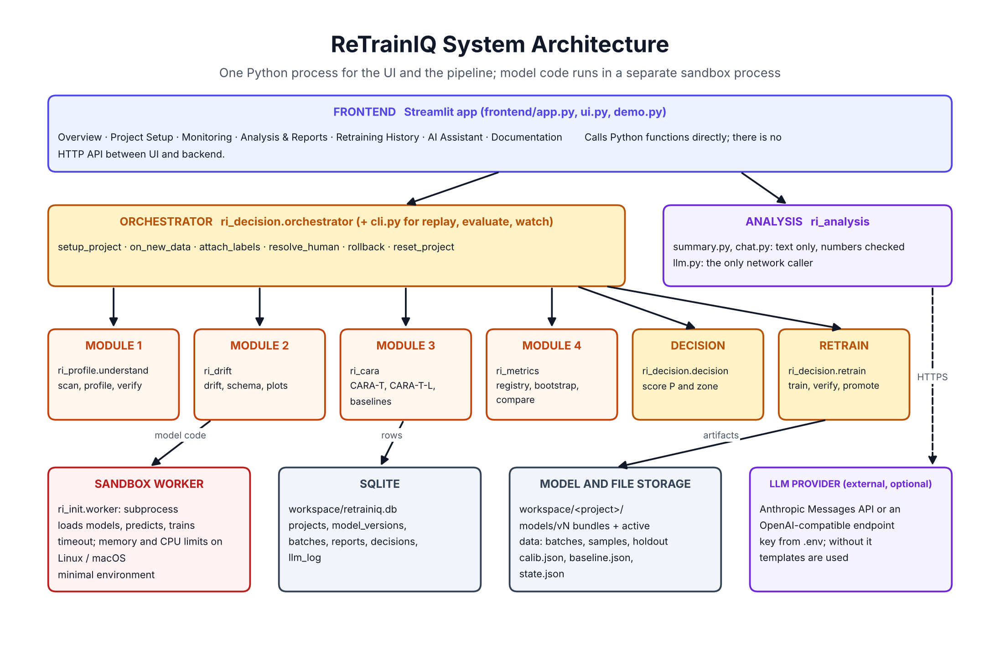

# System architecture

## Components

| Component | Code | Responsibility |
|---|---|---|
| Frontend | `frontend/app.py`, `ui.py`, `demo.py` | Seven sections of one Streamlit app. Displays stored results and calls backend functions. Computes nothing itself. |
| Orchestrator | `6-Decision/ri_decision/orchestrator.py` | The fixed pipeline: validate, batch, run Modules 2 to 4, decide, act, store. Plain Python, not an LLM agent. |
| Module 1 | `1-Profile/ri_profile/understand.py` | Read the project, draft and verify the profile. |
| Module 2 | `2-Drift/ri_drift/` | Drift, schema validation, drift plots, scenario injector. |
| Module 3 | `3-CARA/ri_cara/` | CARA-T calibration and staleness, the label-free estimate, strategy replay. |
| Module 4 | `4-Metrics/ri_metrics/metrics.py` | Metric registry, bootstrap errors, comparison with the baseline. |
| Decision engine | `6-Decision/ri_decision/decision.py` | The score formula and the zones. |
| Retraining engine | `6-Decision/ri_decision/retrain.py` | Train, verify, promote, shadow check, rollback. |
| Analysis | `5-Analysis/ri_analysis/` | LLM client, number-checked summaries, chat. |
| Store | `0-Init/ri_init/store.py` | SQLite access. |
| Sandbox worker | `0-Init/ri_init/worker.py`, `worker_main.py` | Runs every function that loads or trains a model in a separate process. |
| Workspace | `workspace/<project>/` | Models, data, calibration and state files. Git-ignored. |

## How the modules talk to each other

They do not call each other. Each module exposes plain functions that take paths and DataFrames and return JSON-serialisable dictionaries with a `module` and a `status` key. The orchestrator calls them in order and passes results on: drift, staleness and quality dictionaries go into `decide`, and the four dictionaries are stored as one report row. The shapes are fixed in `CONTRACT.md`; `tools/status.py` checks that every function exists with the agreed parameters.

## Database

One SQLite file, `workspace/retrainiq.db`.

| Table | Key columns | Meaning |
|---|---|---|
| `projects` | `id`, `source`, `profile_json`, `status` | One registered ML project. |
| `model_versions` | `project_id`, `version`, `path`, `trained_on`, `status` | v1, v2...; status is `active`, `previous`, `candidate` or `rejected`. |
| `batches` | `project_id`, `file`, `n_rows`, `n_labelled` | One stored batch file. |
| `reports` | `project_id`, `batch_id`, `drift_json`, `cara_json`, `quality_json`, `score_json`, `zone`, `summary` | One check: the evidence of each module, the score and the zone. |
| `decisions` | `report_id`, `action`, `by`, `note` | What was done and by whom (`system`, `human`, `late_labels`). |
| `llm_log` | `model`, `system`, `user`, `response` | Every LLM call. |

Large artefacts (models, data, calibration) are files, not database rows; the database stores their relative paths.

## Model handling

- **Loading.** `joblib.load` only inside the sandbox worker.
- **Evaluation.** The active model scores the uploaded rows itself, so no live prediction log is needed.
- **Retraining.** `sklearn.base.clone(pipeline).fit(X, y)` on the last `W` labelled batches. Training scripts from the user's repository are never run.
- **Promotion.** The candidate is written to `models/vN/` first; then `models/active/model.joblib` is replaced with an atomic file replace.
- **Versions.** Each version folder is a bundle: `model.joblib`, `calib.json`, `baseline.json`, `train_sample.csv`, `reference_stats.json`. Rollback copies the previous bundle back.

## Security

| Risk | Control |
|---|---|
| Malicious repository code | Static text scan only. Nothing from the repository is executed or imported. |
| Malicious ZIP | Absolute paths, `..` components and symlinks are rejected; size and file-count caps (300 MB, 5,000 files). |
| Arbitrary URLs | Only `https://github.com/<owner>/<repo>` is accepted; no credentials prompt. |
| Pickled model files | A pickle can run code when loaded. Loading is confined to the worker subprocess with a timeout, a minimal environment and (Linux, macOS) memory and CPU limits. **This reduces the damage; it is not a full sandbox, and on Windows only the timeout applies. Load only model files you trust.** |
| Prompt injection through repository text | The system prompt marks repository text as data; the LLM output is schema-checked and then verified by code against the real dataset. The LLM cannot trigger any action. |
| Invented numbers in explanations | Every number in LLM text must match the stored report, otherwise the template is used. |
| Secrets | The key lives in `.env`, which is git-ignored; `.env.example` holds empty placeholders. |
| Data leaving the machine | Dataset rows are never sent to the LLM. |

## Known gaps

Classification is the tested path; regression is supported by Modules 2 to 4 but the retraining verification handles classification metrics only. Only scikit-learn pipelines that accept raw rows are supported. There is no user authentication: the app is meant to run locally.
