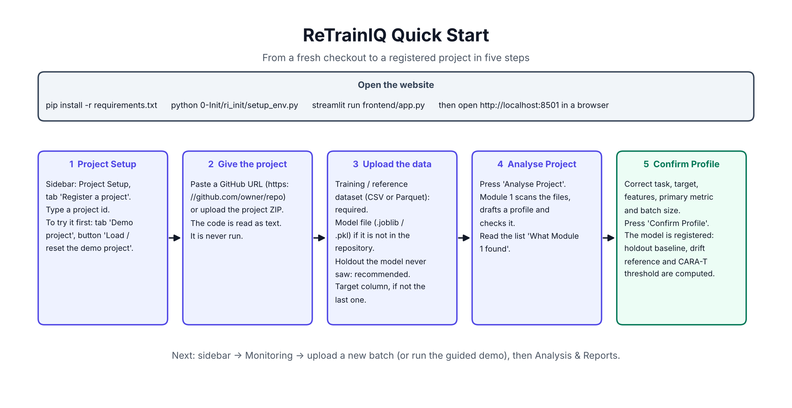

# ReTrainIQ user manual

Visual guides: [Quick start](manual/ReTrainIQ_Quick_Start.png) · [Workflow](manual/ReTrainIQ_Workflow.png) · [Module guide](manual/ReTrainIQ_Module_Guide.png) · [Retraining lifecycle](manual/ReTrainIQ_Retraining_Lifecycle.png) · [System architecture](manual/ReTrainIQ_System_Architecture.png) · [API and data flow](manual/ReTrainIQ_API_Data_Flow.png)



## 1. Start the website

```powershell
.\.venv\Scripts\Activate.ps1
pip install -r requirements.txt
python 0-Init/ri_init/setup_env.py
streamlit run frontend/app.py
```

Open `http://localhost:8501`. The sidebar has the project selector and seven sections.

## 2. Try the demo first

1. **Project Setup → Demo project → Load / reset the demo project.** Takes about a minute.
2. **Monitoring → Guided demo → Run next step**, five times. Each step explains what it does before it runs.
3. **Analysis & Reports**: pick a check and walk through the tabs.

Everything in the demo is simulated and labelled as such.

## 3. Register your own project (Project Setup)

| Field | What to give |
|---|---|
| Project id | A short name, letters and digits. |
| GitHub repository URL | `https://github.com/owner/repo`, public. Or upload the project ZIP. Optional: you can register with the dataset and model only. |
| Training / reference dataset | The data the model was trained on. CSV or Parquet. Required. |
| Trained model artifact | A `.joblib` or `.pkl` scikit-learn Pipeline that accepts raw rows. Needed if it is not in the repository. |
| Holdout | Data the model never saw. Without it the quality comparison is switched off. |
| Target column | Leave blank if it is the last column. |

Press **Analyse Project**. The list "What Module 1 found" shows each step. Then correct the profile form and press **Confirm Profile**. Registration computes the baseline and calibrates CARA-T; it can take a minute.

## 4. Send new data (Monitoring → Upload data)

- **Data file**: the feature columns, and the target column if you already know the outcomes.
- **Labels for this file**: optional separate file with the target, same row order (or the id column from the profile).
- **Run check**: processes the file. Rows wait until a full batch (`batch size B`) has accumulated, so several small uploads are fine.
- **Labels that arrived later**: choose the waiting check, upload the labels file, press **Attach labels**.

## 5. Read a check (Analysis & Reports)

| Tab | What it tells you |
|---|---|
| Summary | Plain-language summary, your Retrain / Keep buttons, report download. |
| ① Drift | STABLE, DRIFT DETECTED or INVALID DATA; PSI per feature; reference versus incoming distributions. |
| ② Staleness | CARA-T staleness against the threshold tau*; measured, estimated, or PENDING. |
| ③ Quality | Metrics against the holdout baseline; confusion matrix; ROC and PR curves. PENDING without labels. |
| ④ Decision | The score, how each signal moved it, the zone, and the What if? sliders. |
| ⑤ Retraining | The eleven pipeline steps and where a candidate passed or failed. |

### What the zones mean

| Zone | Meaning | What to do |
|---|---|---|
| KEEP | Evidence says the model is fine. | Nothing. |
| HUMAN REVIEW | Evidence is mixed, or labels are missing, or a cooldown is active. | Upload labels if you can. Otherwise press Retrain or Keep on the Summary tab. |
| RETRAIN | Strong measured evidence. A candidate was trained automatically. | Check the ⑤ Retraining tab: PROMOTED or VERIFY FAILED. |
| INVALID DATA | The file failed schema validation. | Fix the file (missing column, text in a numeric column) and upload again. |

### Buttons

| Button | Effect |
|---|---|
| Write AI summary | Asks the LLM for a summary; shown only if all its numbers match the report. Needs a key in `.env`. |
| Retrain | Trains and verifies a candidate now. With the tick "Promote even if verification fails" the candidate is promoted regardless. |
| Keep | Records your decision for this batch only. |
| Roll back to vN (Retraining History) | Restores the previous model with its calibration and baseline. |
| Restart demo | Clears the guided demo progress; step 1 resets the demo project. |

## 6. Other sections

- **Overview**: status cards and the timeline of all checks.
- **Retraining History**: versions, every retraining attempt with its verification numbers, rollback.
- **AI Assistant**: questions answered from stored reports only.
- **Documentation**: these documents and the PNG guides inside the app.

## 7. When something goes wrong

| Message | Cause | Fix |
|---|---|---|
| INVALID DATA — upload blocked | A feature column is missing or a numeric column has text. | Correct the file. |
| This exact file was already processed | Same file content uploaded twice. | Upload the new file. |
| 0 batch(es) checked, rows waiting | Fewer than `B` rows so far. | Upload more data. |
| Staleness or quality PENDING | No labels, or under 90% of the batch labelled. | Attach labels. |
| CARA-T calibration status INSUFFICIENT_HISTORY | Fewer than 5,000 labelled reference rows. | Register with more reference data. |
| NO BASELINE | No holdout was given. | Register again with a holdout. |
| INSUFFICIENT_DATA on Retrain | Fewer than 500 training rows or 200 verification rows. | Wait for more labelled data. |
| Worker failed / timed out | The model could not be loaded or took over 15 minutes. | Check the scikit-learn version matches the one that saved the model. |
| Could not read the project | Bad URL, private repository or unsafe ZIP. | Use a public `https://github.com/owner/repo` URL or a clean ZIP. |
| AI summary source: template | No LLM configured, or its text failed the number check. | Set `.env`; otherwise the template is the correct fallback. |

## 8. Command line

```powershell
python -m ri_decision.cli replay   --project demo --batches workspace/demo/data/stream --limit 30
python -m ri_decision.cli evaluate --project demo
python -m ri_decision.cli watch    --project demo --incoming workspace/demo/incoming --every 1d
```

`watch` checks a folder on a schedule (`5h`, `1d`, `1w`). A file named `labels_<batch_id>.csv` is attached to that batch.
